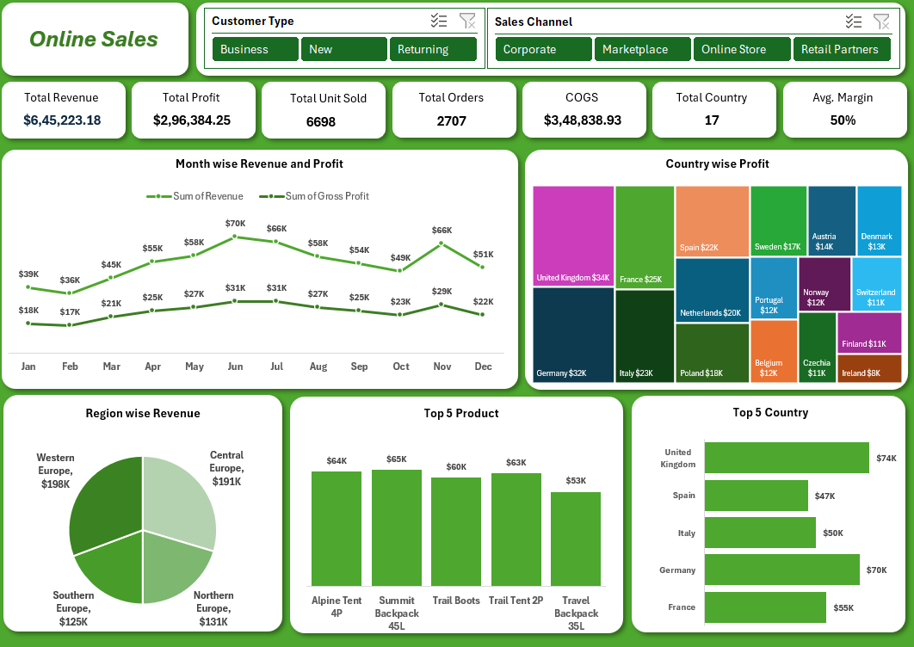

# 📊 Online Sales Performance Dashboard | Excel Data Analytics Project

## 📌 Project Overview

This project presents an interactive **Online Sales Performance Dashboard** created using Microsoft Excel.

The dashboard provides meaningful insights into revenue, profit, orders, products, countries, and regional sales performance through interactive charts, KPI cards, and slicers.

## 📷 Dashboard Preview

## 🎯 Key Performance Indicators (KPIs)

| KPI | Value |
|---|---:|
| Total Revenue | $645,223.18 |
| Total Profit | $296,384.25 |
| Total Units Sold | 6,698 |
| Total Orders | 2,707 |
| COGS | $348,838.93 |
| Total Countries | 17 |
| Average Margin | 50% |

## 📈 Dashboard Features

- Month-wise Revenue and Profit Analysis
- Country-wise Profit Analysis
- Region-wise Revenue Analysis
- Top 5 Product Performance
- Top 5 Country Revenue
- Customer Type Analysis
- Sales Channel Analysis
- Interactive Excel Slicers and Filters

## 🛠️ Tools & Technologies

- Microsoft Excel
- Pivot Tables
- Excel Charts
- Slicers
- KPI Cards
- Data Cleaning
- Data Analysis
- Data Visualization

## 📊 Business Insights

- Analyzed monthly revenue and profit trends.
- Identified countries generating the highest profit.
- Compared revenue performance across different regions.
- Identified the top 5 performing products.
- Analyzed the top 5 countries based on revenue.
- Compared Business, New, and Returning customer segments.
- Evaluated different sales channels.

## 💡 Project Objective

The objective of this project is to convert raw sales data into meaningful business insights using Microsoft Excel, interactive dashboards, and data visualization techniques.

## 👨‍💻 Author

**Kaleem Asharaf**

## ⭐ Feedback

If you find this project useful, feel free to explore the repository and share your feedback.

---
**Thank You for Visiting My Project!**
